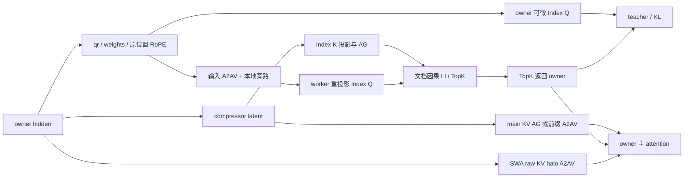

# DeepSeek V4.1 Indexer 负载均衡与 CP 通信

## 适用范围

本功能在 `SharedCompressedDSAAttention` 中重新分配普通因果 Indexer 的 TopK **选择任务**。
主 attention、teacher、KL 和输出保持原 Q owner；Indexer 参数仍通过 owner 上的 KL 更新。
支持压缩率 1/2、Full/Reindex/Reuse，以及单文档和自然长度的 packed 文档。

启用均衡需要 CP>1、TP=1、micro-batch=1、等长连续 Q 分片，所有 rank 使用同一份文档边界及配置。
r2 按每篇文档独立构造完整压缩块，文档边界和 local Q 可以为奇数；尾部不足一块的 token 仍参与 raw attention。
跨 CP 的完整块由最后一个 token 所在 rank 持有，各 rank 的 compressed K 行数可不同或为零。
不添加 token 或跨文档组块。后训练 candidate pool 不支持任务均衡。
融合开关与均衡选项独立；`use_fused_ops: true` 继续要求相应原生算子，且不静默回退。

## 配置

在已有 V4.1 示例的 attention replacement 中加入以下选项；CP mesh 和数据切分沿用原训练配置。

```yaml
plan_overrides:
  - match: "model.layers.*.self_attn"
    module_type: hyper_parallel.models.deepseek_v41.modeling_deepseek_v41.DeepseekV41Attention
    replace_module:
      _target_: hyper_parallel.components.modules.shared_compressed_dsa_attention.SharedCompressedDSAAttention
      use_fused_ops: true
      main_kv_comm: all_to_all_v
      indexer_load_balance: greedy
      indexer_balance_block_size: 2048
```

| 选项 | 默认值 | 作用 |
|---|---|---|
| `indexer_load_balance` | `none` | `none`、`zigzag`、`greedy`、`hybrid` |
| `indexer_balance_block_size` | greedy/hybrid 下为 `2048` | greedy 池每个原始任务的最大 Q 行数，需为正整数且不超过 local Q；none/zigzag 必须省略 |
| `indexer_zigzag_min_length` | 不设置 | hybrid 必填的长文档阈值，单位为原始 token；其他模式必须省略 |
| `main_kv_comm` | `all_gather` | main compressed KV 使用 `all_gather` 或文档因果前缀 `all_to_all_v` |

`hybrid` 示例：设置 `indexer_load_balance: hybrid`、`indexer_balance_block_size: 2048`、
`indexer_zigzag_min_length: 65536`。这里的阈值仅为配置示例，应按文档分布测量后选取。
没有第二个最小 zigzag 片段阈值。

SWA raw KV 固定使用 all-to-all-v halo，没有 AG 配置选项。Index K 保持可微 all-gather。
自然文档的 AG 临时补齐通信容量后去掉空槽；main A2AV 按实际 owner K 行数分发。
公共异步 all-gather 的反向通过 SUM reduce-scatter 返回 owner 的梯度，保留原 dtype 和 SUM 缩放语义。

## 任务划分

- **zigzag**：文档长度 `L` 分成 `2*CP` 个等长主体片段，余数留在开头；每个 worker 接收一对头尾片段。
  所有文档的真实余数行汇总后均分，不要求每篇文档被 `2*CP` 整除，不增加 padding token。
- **greedy**：每篇文档按 block size 从头切分，最后不足一个 block 的部分保留为短任务。
  按任务的可见因果 Q/K pair 数降序，将任务交给当前累计工作量最少且容量足够的 worker。
- **hybrid**：达到长文档阈值且至少能分出一个完整头尾对的文档，其主体采用 zigzag；
  其开头余数与其余文档进入同一个 greedy 池，共用已有工作量和 Q 容量预算。

任务工作量为 `sum(floor((q+1)/ratio))`，其中 `q` 是文档内的原始 query 位置。
同一 worker 上相邻、同文档的任务会合并。zigzag 保持各 worker 的 Q 行数相等；
greedy/hybrid 的 Q 行数最多为原 local Q 的两倍，并不保证 Q 行数相等。
任务工作量是计算量估计，不包含实际通信和 kernel 启动耗时。

## 前向和反向流程

1. 从全局文档边界生成可缓存的任务及通信路由。每个 rank 独立得到同一任务分配，
   据原 owner 连续分片计算发送行、接收行、本地旁路行和 TopK 返回行。
2. owner 由 hidden 生成低秩 `qr` 和 Indexer weights；以 `no_grad` 分发 qr、weights、原位置 cos/sin。
   相同 dtype 的字段合并发送，不降低 RoPE 精度；属于本 rank 的行直接旁路。
3. Full 层由 compressor latent 投影 Index K 并发起 AG，再发起 main KV 通信及主 Q 投影。
   worker 收到 qr 后重新投影 Index Q，使用文档局部因果范围执行 LI；Reindex 复用已有 Index K。
4. TopK ID 通过逆向路由返回原 owner，其间执行 owner 的可微 Index Q 投影。
   owner 的 Index Q/weights 与共享 Index K 保留 KL 的参数梯度。
5. owner 用原来的 Q 布局执行 teacher、KL、SWA+main attention、输出投影。
   均衡只改变选择任务位置，不移动 KL 和主 attention 的训练布局。



Index K 和 main KV 在同一 CP group 上按一致顺序启动；异步接口提供可重叠的独立计算窗口，
并不保证通信一定完全被隐藏。真正消费收到的数据之前必须 wait。
Full 层先发起选择输入分发，再发起 Index K AG、main KV 通信；worker 投影和 LI 完成后才发起 TopK 返回。
main KV 若仍占用串行通信队列，会推迟 TopK 返回；不能根据小 CP 的重叠情况推断大 CP 下没有等待。
TopK 返回期间执行的是 KL 必需的 owner 投影；额外的 worker 投影在 LI 前，不能覆盖同一批 TopK 返回。
Reindex 复用共享 bank，不产生新的 Index K/main KV 通信。自然文档跨 rank 压缩另有块起点 RoPE 与投影值的边界交换。
worker 投影保留原 owner 的 GEMM 行数，尾块仅在无梯度投影中 padding，padding 行不进入 LI。
重计算通过已有 checkpoint exclusion 缓存离散选择及其通信结果，避免重复消费异步 handle。

main KV 前缀从本 rank 首个相关文档起点到本地 Q 分片末尾，只包含相关文档的因果前缀；
通过 compact key offset 供 attention 和 KL 解释原 TopK ID。compact K 按各文档完整块数累加，
raw 文档起点独立保存，不能由 K ID 乘压缩率反推。各层共享同一个 source bank 及其 offset。
SWA halo 则只收集本 rank 开头窗口缺少的同文档 raw KV，窗口不跨文档。
两类 A2AV 反向均反转路由并将多个 consumer 的梯度 SUM 到原 owner，本地梯度先复制再累加，避免改写上游梯度别名。

## 测量建议

先固定输入、参数、算子和 main KV 配置，对比 none/zigzag/greedy/hybrid 的 TopK、输出和梯度；
再分别测选择路径与整层前后向。长文档的 LI 扫描不均衡更明显，碎文档节省的绝对 LI 时间可能不足以覆盖
qr 分发、worker 重投影、TopK 返回以及重复 K 前缀打包成本。
不要将 LI 单算子收益等同于整层或整模型收益。

TopK 的并列分数没有跨调用形状的稳定 ID 顺序保证。即使 worker 的 Q/K/weights 完全相同，
BSND/TND 或不同任务片段形状仍可能选择不同的等分 key，进而影响后续层和优化器更新。
重计算复用的是本次前向已选定的 ID；它不承诺不同均衡模式之间的 TopK 逐位相同。
